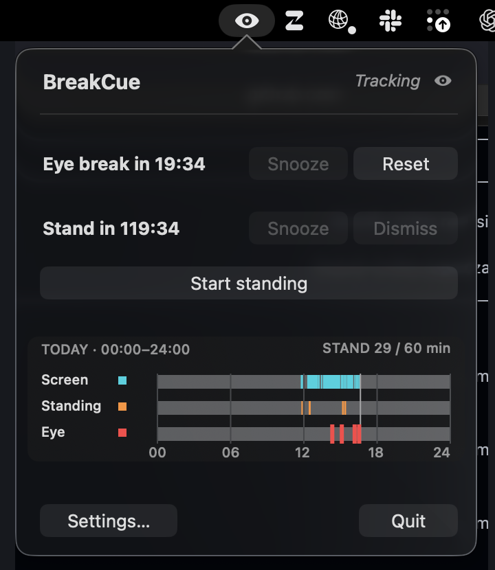

# BreakCue

BreakCue is a macOS menu bar app that tracks active screen time and reminds you to rest your eyes and stand. It includes configurable timers and a daily activity timeline.



## Build from source

Requires macOS 13 or later, Rust, and the Apple command line tools. From this repository:

```sh
./package.sh
open dist/BreakCue.dmg
```

> **Contributing:** See [CONTRIBUTING.md](CONTRIBUTING.md) for setup, checks, and pull request guidance.

## License

Licensed under either of

- Apache License, Version 2.0 ([LICENSE-APACHE](LICENSE-APACHE) or <https://www.apache.org/licenses/LICENSE-2.0>)
- MIT license ([LICENSE-MIT](LICENSE-MIT) or <https://opensource.org/licenses/MIT>)

at your option.

Unless you explicitly state otherwise, any contribution intentionally submitted for inclusion in BreakCue by you, as defined in the Apache-2.0 license, shall be dual licensed as above, without any additional terms or conditions.
